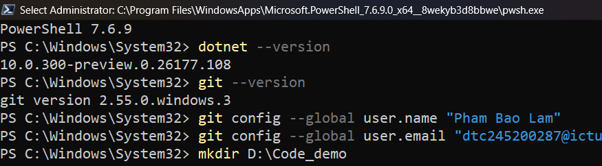
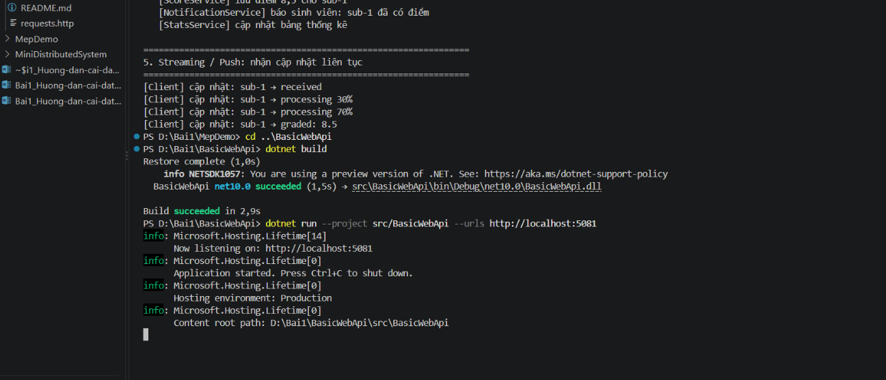
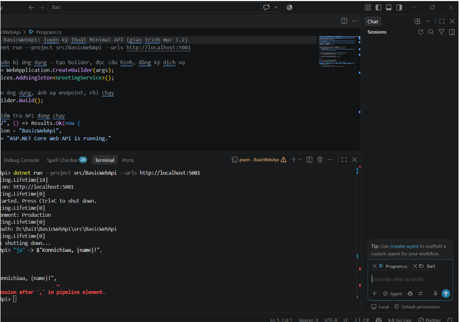
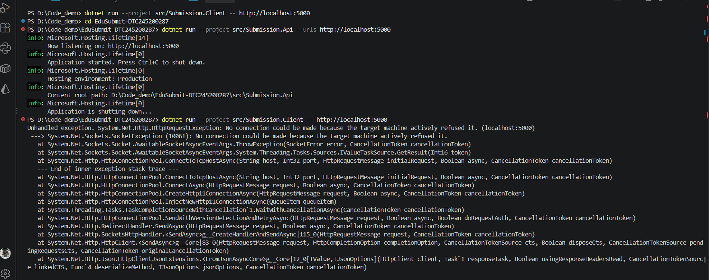
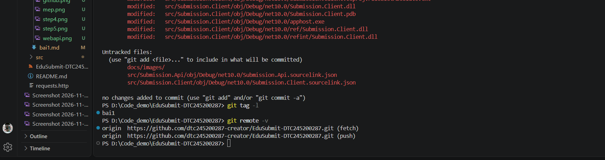

# Bài 1 – Tổng quan hệ thống và MEP
Họ tên: Phạm Bảo Lâm | MSSV: DTC245200287 | Lớp: CNTTK23E

## 1. Cài đặt môi trường (Bước 4)

## 2. MepDemo (Bước 7)

## 3. BasicWebApi (Bước 8)

## 4. Dự án EduSubmit (Bước 9 & 11)

## 5. Thí nghiệm lỗi (Bước 10)
| # | Dự đoán | Thực tế | Đúng/Sai | Giải thích |
| a | Client vẫn nhận bài 3 | Thành công | Đúng | DTO tự thích ứng với JSON mới |
| b | Báo lỗi kết nối | Connection refused | Đúng | API chưa khởi chạy |
| c | Trả lỗi 400 Bad Request | HTTP 400 Bad Request | Đúng | Server validate dữ liệu rỗng |
| d | Đổi cổng 5050 chạy được | Thành công | Đúng | URL truyền qua tham số args[0] |

## 6. Đẩy code lên GitHub (Bước 13)

## Bước 7 - Phân tích request/response

`Submission.Client` gửi HTTP request tới `Submission.Api`; hai project chỉ thống nhất hình dạng JSON, không tham chiếu mã nguồn của nhau.

| Tác vụ | Request | Response mong đợi |
|---|---|---|
| Kiểm tra API | `GET /` | `200 OK`, service `Submission.Api`, status `running` |
| Lấy bài tập | `GET /api/assignments` | `200 OK`, mảng 3 bài tập |
| Nộp bài | `POST /api/submissions` với `assignmentId`, `studentCode`, `repositoryUrl` | `201 Created`, JSON lượt nộp và `Location: /api/submissions/{id}` |
| Tra cứu | `GET /api/submissions/{id}` | `200 OK`, JSON lượt nộp đã lưu |

## Bước 8 - Vai trò của hai tiến trình

- `Submission.Api` là máy chủ: lắng nghe HTTP, kiểm tra dữ liệu, tạo `Guid`, lưu lượt nộp và trả mã trạng thái.
- `Submission.Client` là máy khách: gọi API qua `HttpClient`, đọc JSON, kiểm tra lỗi bằng `EnsureSuccessStatusCode()` và gọi GET tra cứu sau khi POST.
- Hai tiến trình có thể chạy độc lập. API không biết client cụ thể nào đang gọi nó.
- Kho dữ liệu hiện dùng `ConcurrentDictionary` trong bộ nhớ để minh họa; khởi động lại API sẽ xóa dữ liệu.

## Bước 9 - Bài mở rộng GET theo id

POST trả về `id` và đồng thời lưu `SubmissionResult` vào kho trong bộ nhớ. Endpoint `GET /api/submissions/{id:guid}` dùng id đó để tìm bản ghi:

- Tìm thấy: trả `200 OK` và bản ghi lượt nộp.
- Không tìm thấy: trả `404 Not Found` cùng thông báo lỗi.
- Chuỗi không phải GUID không khớp route constraint và cũng không được xử lý như một id hợp lệ.

Client gọi lại endpoint này bằng chính `id` vừa nhận được, qua đó kiểm tra rằng dữ liệu đã được lưu và có thể truy xuất.

## Bước 10 - Bảng thí nghiệm lỗi

| Thí nghiệm | Cách thực hiện | Kết quả quan sát | Giải thích |
|---|---|---|---|
| API tắt | Tắt tiến trình API rồi chạy client | `HttpRequestException` hoặc lỗi kết nối | Không có tiến trình lắng nghe tại địa chỉ HTTP |
| Thiếu `StudentCode` | POST với `studentCode: ""` | `400 Bad Request` | API kiểm tra chuỗi rỗng trước khi tạo lượt nộp |
| Thiếu `RepositoryUrl` | Bỏ trường hoặc gửi chuỗi rỗng | `400 Bad Request` | Dữ liệu bắt buộc không hợp lệ |
| `AssignmentId` không dương | Gửi `assignmentId: 0` | `400 Bad Request` | API chỉ nhận mã bài tập dương |
| Tra cứu id lạ | GET với GUID toàn số 0 | `404 Not Found` | Không có bản ghi tương ứng trong kho |
| JSON sai kiểu | Gửi chuỗi cho `assignmentId` | `400 Bad Request` | ASP.NET Core không bind được request body vào kiểu dữ liệu |

## Kết luận

Bài thực hành cho thấy mô hình request-response qua HTTP: client gửi request, API xử lý độc lập và trả status code cùng JSON. `201 Created` kèm `Location` phù hợp khi tạo tài nguyên; `400` dùng cho dữ liệu đầu vào không hợp lệ và `404` dùng khi tài nguyên không tồn tại.
