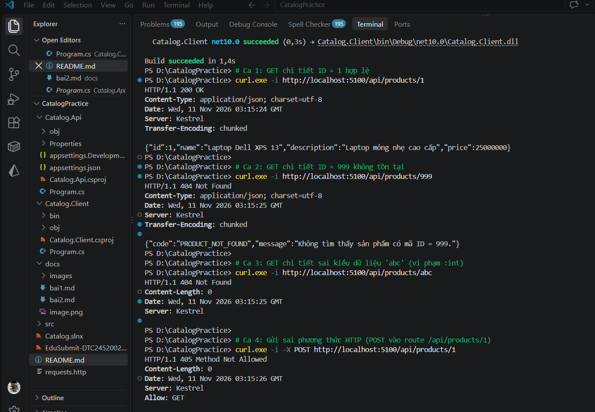
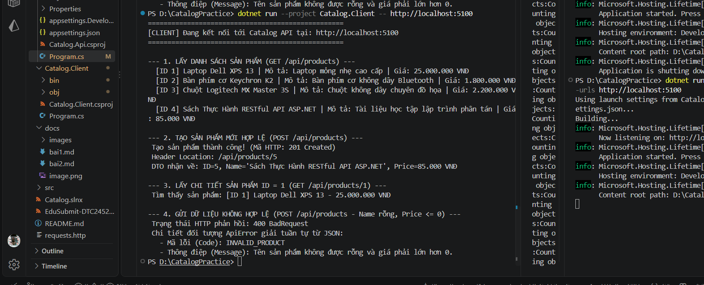
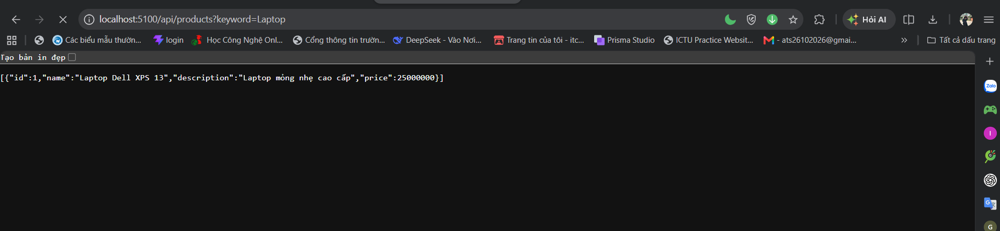
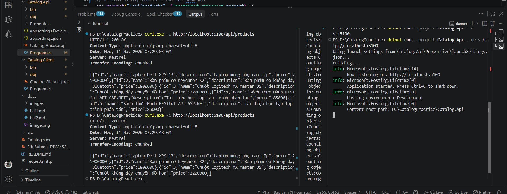
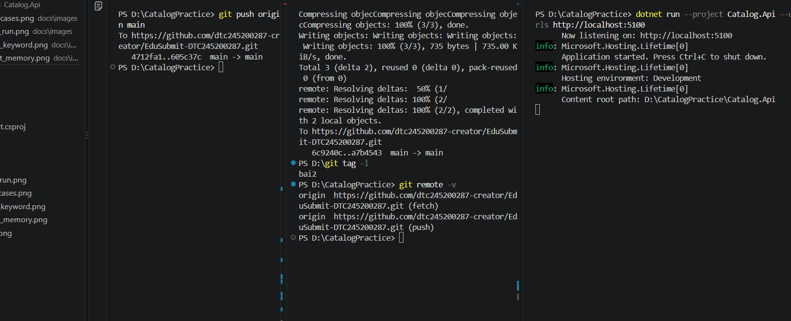

# Bài 2 – RESTful API Catalog API
Họ tên: Phạm Bảo Lâm | MSSV: DTC245200287 | Lớp: CNTTK23E

## 1. Thử nghiệm 4 ca HTTP chi tiết (Bước 4)

## 2. Chạy ứng dụng Catalog.Client (Bước 11)

## 3. Bài mở rộng lọc Query String keyword (Bước 13)

## 4. So sánh dữ liệu In-Memory trước và sau khi restart (Bước 14)

## 5. Thí nghiệm lỗi (Bước 10)
| # | Dự đoán | Thực tế | Đúng/Sai | Giải thích |
|---|---|---|---|---|
| a | Client nhận danh sách sản phẩm | Thành công | Đúng | DTO tự thích ứng với mảng JSON mới |
| b | Báo lỗi kết nối | Connection refused | Đúng | API chưa khởi chạy |
| c | Trả lỗi 400 Bad Request | HTTP 400 Bad Request | Đúng | Server validate tên rỗng và giá <= 0 |
| d | Trả lỗi 404 có ApiError | HTTP 404 Not Found | Đúng | Handler tự trả 404 kèm body ApiError |
| e | Trả lỗi 404 body rỗng | HTTP 404 Not Found | Đúng | Route constraint :int chặn từ tầng Framework |

## 6. Đẩy code lên GitHub (Bước 13)

## Bước 7 - Phân tích request/response

`Catalog.Client` gửi HTTP request tới `Catalog.Api`; hai project chỉ thống nhất hình dạng JSON, không tham chiếu mã nguồn của nhau.

| Tác vụ | Request | Response mong đợi |
|---|---|---|
| Kiểm tra API | `GET /` | `200 OK`, service `Catalog API`, status `Healthy` |
| Lấy danh sách | `GET /api/products` | `200 OK`, mảng 3 sản phẩm ban đầu |
| Lấy chi tiết | `GET /api/products/1` | `200 OK`, JSON sản phẩm ID 1 |
| Lấy chi tiết lỗi ID | `GET /api/products/999` | `404 Not Found`, JSON `ApiError` code `PRODUCT_NOT_FOUND` |
| Vi phạm constraint | `GET /api/products/abc` | `404 Not Found`, `Content-Length: 0` |
| Tạo sản phẩm | `POST /api/products` với `name`, `price` | `201 Created`, JSON sản phẩm mới và `Location: /api/products/{id}` |
| Tạo lỗi dữ liệu | `POST /api/products` với `name=""`, `price=-50000` | `400 Bad Request`, JSON `ApiError` code `INVALID_PRODUCT` |
| Lọc keyword | `GET /api/products?keyword=Laptop` | `200 OK`, JSON mảng sản phẩm phù hợp |

## Bước 8 - Vai trò của hai tiến trình

- Hai tiến trình có thể chạy độc lập. API không biết client cụ thể nào đang gọi nó.
- Kho dữ liệu hiện dùng `List<ProductDto>` trong bộ nhớ RAM để minh họa; khởi động lại API sẽ xóa dữ liệu và khôi phục về trạng thái ban đầu.

## Bước 9 - Bài mở rộng GET theo id và Query String

- Phương thức `POST` trả về `id` và đồng thời thêm sản phẩm mới vào danh sách trong bộ nhớ. Endpoint `GET /api/products/{id:int}` dùng `id` đó để tìm bản ghi:
  - Tìm thấy: trả `200 OK` và bản ghi sản phẩm.
  - Không tìm thấy (`/999`): trả `404 Not Found` cùng thông báo lỗi `ApiError` do Handler tự sinh.
  - Chuỗi không phải kiểu số nguyên (`/abc`): không khớp route constraint `:int` và bị Framework chặn ngay từ tầng định tuyến (body rỗng).
- Endpoint `GET /api/products?keyword=...` nhận tham số query string để lọc danh sách theo tên hoặc mô tả sản phẩm.

## Bước 10 - Bảng thí nghiệm lỗi

| Thí nghiệm | Cách thực hiện | Kết quả quan sát | Giải thích |
|---|---|---|---|
| API tắt | Tắt tiến trình API rồi chạy client | `HttpRequestException` hoặc lỗi kết nối | Không có tiến trình lắng nghe tại địa chỉ HTTP |
| Thiếu `Name` | `POST` với `Name = ""` | `400 Bad Request` | API kiểm tra chuỗi rỗng trước khi tạo sản phẩm |
| `Price` âm | `POST` với `Price = -50000` | `400 Bad Request` | Dữ liệu giá phải lớn hơn 0 |
| Tra cứu ID không tồn tại | `GET` với ID `999` | `404 Not Found` | Handler không tìm thấy bản ghi tương ứng |
| ID sai kiểu dữ liệu | `GET` với `abc` | `404 Not Found` | ASP.NET Core không bind được tham số vào kiểu `:int` |

## Kết luận

Bài thực hành cho thấy mô hình request-response qua HTTP: client gửi request, API xử lý độc lập và trả status code cùng JSON. `201 Created` kèm `Location` phù hợp khi tạo tài nguyên; `400 Bad Request` dùng cho dữ liệu đầu vào không hợp lệ và `404 Not Found` dùng khi tài nguyên không tồn tại.